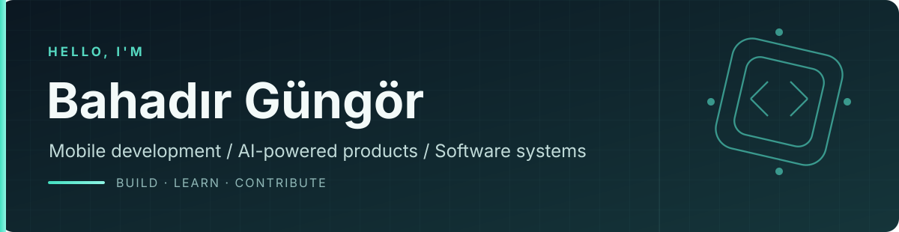

 

**Computer Engineering · Karadeniz Technical University**

I build mobile and web products, with a focus on thoughtful user experiences and reliable backend engineering.

[LinkedIn](https://www.linkedin.com/in/mehmetbahadirgungor/) &nbsp;·&nbsp; [Athlor](https://athlor.fit/) &nbsp;·&nbsp; [OLLSTAR](https://ollstar.com/) &nbsp;·&nbsp; [Repositories](https://github.com/mehmetbahadirgungor?tab=repositories)

---

### 01 / Featured products

#### [Athlor](https://athlor.fit/) — AI-powered fitness & nutrition

A fitness and nutrition app released for **iOS and Android**, combining personalized training, food tracking, and AI guidance.

- **Fitness:** Personalized workout plans, exercise tracking, and progress insights.
- **Nutrition:** Food recognition, meal logging, and macro tracking.
- **AI:** Gemini-powered coaching and personalized recommendations.
- **Engineering:** Flutter application, Firebase, Node.js / TypeScript backend, Python API, and Next.js website.

<strong>Stack:</strong> Flutter · Dart · GetX · Firebase · Node.js · TypeScript · Python · Gemini

Independent product · Private source · Currently in maintenance mode

#### [OLLSTAR](https://ollstar.com/) — Creator & fan marketplace

A **team-developed mobile and web platform** connecting creators with fans through paid, personalized experiences.

- **Experiences:** One-to-one video calls, session bookings, and creator subscriptions.
- **Platform:** Creator discovery, payments, moderation, and account management.
- **Engineering:** Flutter clients, NestJS backend, Supabase / PostgreSQL, and LiveKit real-time calls.

<strong>Stack:</strong> Flutter · Flutter Web · NestJS · Supabase · PostgreSQL · LiveKit

Team project · Private repository · In development

---

### 02 / Selected public projects

<table>
<tr>
<td width="50%" valign="top">

#### [Gaston](https://github.com/mehmetbahadirgungor/gaston)

**Fuel ordering & delivery**

A mobile prototype for scheduling fuel delivery, with vehicle location, Google Maps, order flows, and QR-based verification.

Flutter · GetX · Firebase · Google Maps

</td>
<td width="50%" valign="top">

#### [BookMedia](https://github.com/mehmetbahadirgungor/BookMedia)

**Book discovery & library**

Search books via the Google Books API, explore details, manage a personal library, and use Firebase-backed accounts and comments.

Flutter · Dart · Firebase · Google Books API

</td>
</tr>
<tr>
<td width="50%" valign="top">

#### [Django Course App](https://github.com/mehmetbahadirgungor/courseapp-WebProjectwithDjango)

**Course catalog & accounts**

A Django web application with category browsing, paginated course listings, and user registration and login.

Python · Django · SQLite · HTML

</td>
<td width="50%" valign="top">

#### [WatchBase Data Scraping](https://github.com/mehmetbahadirgungor/DataScrapingFromWatchBase)

**Data collection & exploration**

Python-based watch data extraction, structured CSV datasets, and Jupyter notebooks for exploration.

Python · Web Scraping · Jupyter · CSV

</td>
</tr>
</table>

Also: [Car Data Scraping & Machine Learning](https://github.com/mehmetbahadirgungor/Data-Scraping-and-ML-from-CarsData)

---

### 03 / Open-source contributions

**[flutter_cache_manager · PR #542](https://github.com/Baseflow/flutter_cache_manager/pull/542)** — **Merged**  
Improved error handling for asynchronous cache metadata updates and database failures.

**[flutter_slidable · PR #552](https://github.com/letsar/flutter_slidable/pull/552)** — **Open**  
Proposed gesture improvements to prevent unintended sliding during diagonal scrolling.

---

### 04 / Tech & interests

| Focus | Technologies |
| :-- | :-- |
| **Mobile** | Flutter, Dart, GetX, Firebase |
| **Backend & web** | Node.js, TypeScript, Python, NestJS, Django, Next.js |
| **Data** | PostgreSQL, Supabase, web scraping |

**Exploring:** Cybersecurity — an area of interest and ongoing learning, not yet represented by a project.

### 05 / Recognition

**Engineering Project of the Year — Second-Year Category (2024–2025)**  
Beykoz University · *Athlor MVP*
